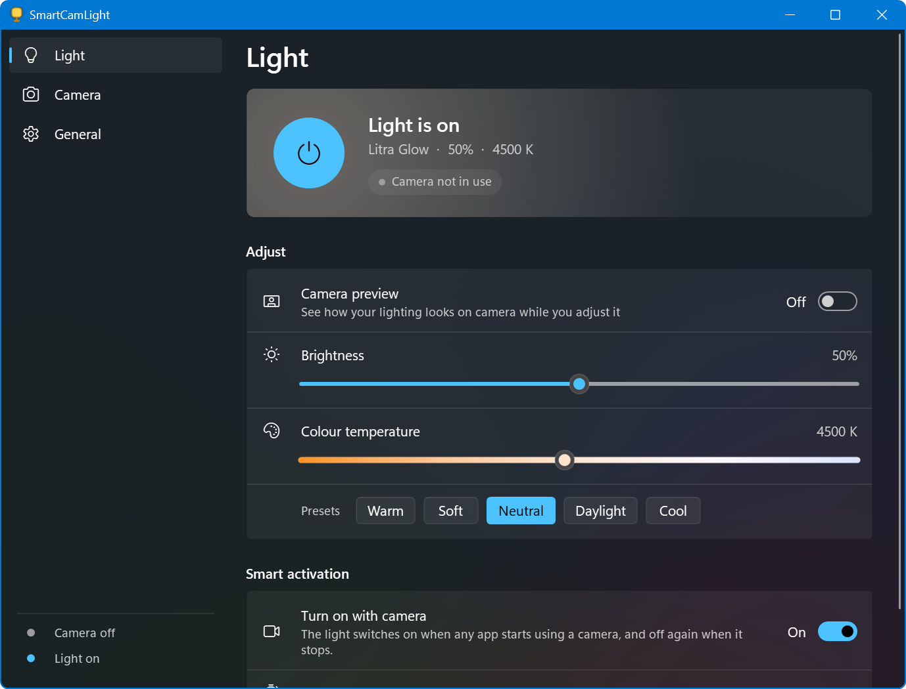
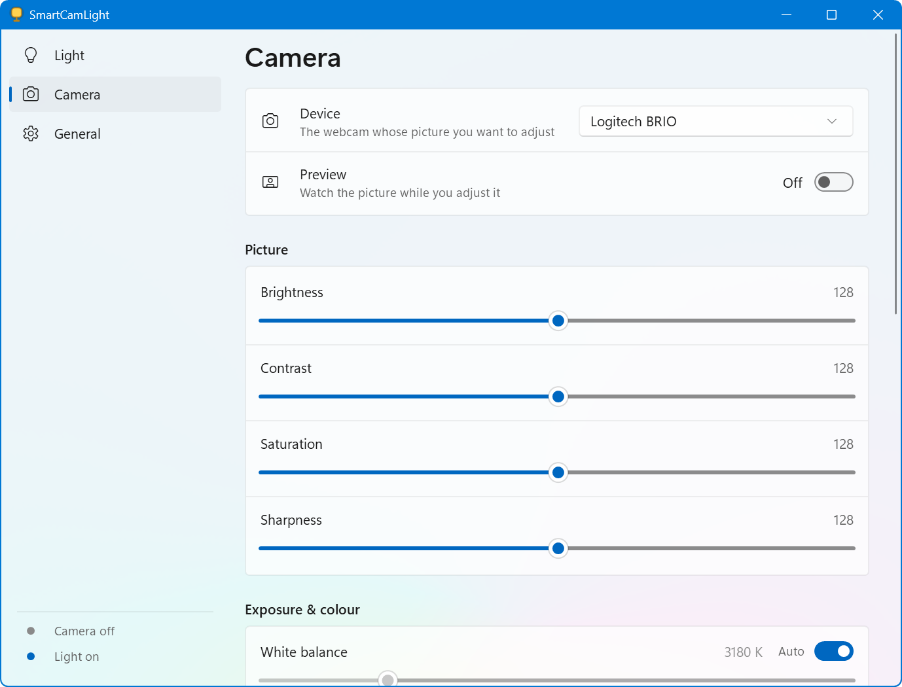

# SmartCamLight

A small Windows tray app that turns your **Logitech Litra** light on when your camera starts and off when it stops. It also gives you full control over the light and your webcam's picture settings, with no Logi Tune needed.



## Why?

Logi Tune's *Smart Activation* stopped working on recent Windows 11 builds. Older tools detect "camera on" from the privacy registry (`CapabilityAccessManager\ConsentStore\webcam`), which current Windows builds no longer update reliably. SmartCamLight uses Windows' **Media Foundation Sensor Activity Monitor** instead: Windows notifies it as soon as any app starts or stops streaming from a camera. It works with Zoom, Teams, Discord, browsers, OBS and everything else.

## Features

- **Smart activation**: the light turns on when any app starts using a camera, and off when it stops, after a delay you choose.
- **Light control**: power, brightness and colour temperature (2700–6500 K), plus presets. Use the settings window, or right-click the tray icon for live sliders.
- **Camera preview**: watch yourself on camera while you tune the light or the picture. With smart activation on, the light comes on with the preview, just as it will in a call. The camera only runs while the preview switch is on.
- **Webcam settings**: brightness, contrast, saturation, hue, sharpness, white balance, exposure, gain, backlight compensation, zoom, focus, pan and tilt, with Auto where the camera supports it. Your values are re-applied whenever the camera reconnects.
- **Ignore list**: apps whose camera use shouldn't trigger the light.
- **Starts with Windows**, quietly in the tray.
- **Looks at home on Windows 11**: Mica backdrop, your accent colour, dark or light mode (it switches live with Windows), and sharp text on every monitor, including mixed-DPI setups.
- **Native on Windows on ARM**: there is a separate ARM64 build for Snapdragon PCs, so nothing runs under emulation.
- One small `.exe` with no installer, no runtime to install and no background services.



## Supported devices

| Device | Support |
| --- | --- |
| Logitech Litra Glow | ✅ Tested |
| Logitech Litra Beam | ✅ Same protocol (untested) |
| Logitech Litra Beam LX, other lights | ❌ Not yet (contributions welcome) |
| Webcams | Smart activation works with any camera. Picture settings work with any standard USB (UVC) webcam. Tested with the OBSBOT Meet 2. |

Requires Windows 10 (2004 or later) or Windows 11. Developed on Windows 11 build 26200. The Mica backdrop needs Windows 11 22H2 or later; older versions get a plain background. The ARM64 build needs Windows 11.

## Install

1. Download the app from the [latest release](../../releases/latest):
   - `SmartCamLight.exe` for ordinary (x64) PCs
   - `SmartCamLight-arm64.exe` for Windows on ARM (Snapdragon) PCs
2. Put it somewhere permanent, for example `%LOCALAPPDATA%\Programs\SmartCamLight\`.
3. Run it. The app is unsigned, so Windows SmartScreen may warn you: click **More info → Run anyway**. You can also build it yourself from source (see below).
4. Click the tray icon to open the settings. Turn on **Start with Windows** on the General page.

If Logi Tune is installed, quit it or turn off its Smart Activation so the two apps don't fight over the light.

## Build from source

```powershell
.\build.ps1
```

This uses the C# compiler that ships with Windows (.NET Framework 4.8), so there's nothing to install. The output is `bin\SmartCamLight.exe`.

For a native Windows on ARM build:

```powershell
.\build.ps1 -Platform arm64
```

The output is `bin\SmartCamLight-arm64.exe`. The compiler that ships with Windows can't target ARM64, so this needs the Roslyn compiler from the [.NET SDK](https://dot.net) or Visual Studio. The app itself still runs on the .NET Framework that is part of Windows. (`-Platform x64` works the same way.)

To try the interface without touching anything, start the app with `--preview`: nothing is sent to the light or the camera, and no settings are saved. `--dark` and `--light` override the Windows theme.

## How it works

| Part | File |
| --- | --- |
| Camera detection (Media Foundation sensor activity monitor, registry fallback) | `src/SensorMonitor.cs`, `src/CameraUsage.cs` |
| Litra control over raw HID | `src/Litra.cs` |
| Webcam settings through DirectShow (`IAMVideoProcAmp` / `IAMCameraControl`) | `src/UvcCamera.cs` |
| Live camera preview (Media Foundation source reader) | `src/CameraFeed.cs` |
| Tray app and smart activation logic | `src/TrayApp.cs` |
| Tray menu sliders | `src/TrayMenu.cs` |
| Settings window and custom controls | `src/SettingsForm.cs`, `src/Controls.cs` |
| Theme, Mica backdrop and drawing (controls render with an alpha channel so the backdrop shows through) | `src/Ui.cs` |

Settings and the log are stored in `%APPDATA%\SmartCamLight\`.

## Limitations

- OBSBOT-specific features (AI tracking and framing, HDR, gestures) use a private vendor protocol. Use OBSBOT Center for those.
- The camera's own picture settings are standard UVC controls. What's available depends on the camera.

## Credits

The Litra HID commands were first documented by the open-source community, notably [timrogers/litra](https://github.com/timrogers/litra).

## License

[MIT](LICENSE)

*Not affiliated with Logitech or OBSBOT. Product names are trademarks of their respective owners.*
